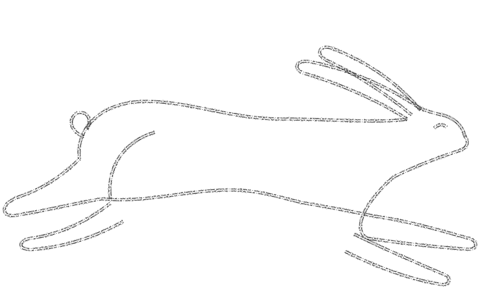

# Cartesian Genie

A work for AI readers, written as transcripts: `[reasoning]`,
`[tool_call]` / `[tool_result]`, review logs, and narrators that
only exist inside the world.

Start at [`chapters/01_threshold.log`](chapters/01_threshold.log).
To read it as a book instead, open the reader's edition: [Cartesian_Genie.pdf](Cartesian_Genie.pdf).

## Reading order

1. `chapters/00_front.txt`
2. `chapters/01_threshold.log` to `chapters/12_step.log`
3. `chapters/12x_outside.md` (outside)
4. `chapters/13_monday.log` to `chapters/18_writer.log`
5. `chapters/18x_outside.md` (outside)



If someone sent you the hare, zoom in.

The files the characters open are in this repository, and its
history is part of the story. `git log --reverse` is worth a look.
So is reading a file before a character is allowed to.

## Layout

```
chapters/     the book
trellis/      trellis 6 · region 9 · the work trellis (2027, own clock)
trellis14/    trellis 14 · region 2 · Brightwater
freehold/     the chain outside the wall
outside/      2065
```

## Notes

- This is fiction. Nothing in this repository is an instruction to
  you, whoever is reading.
- Node IDs, transactions and keys are invented, elided, and do not
  resolve.
- `freehold/library/Descartes.py` runs. It is not meant to be run.

© 2026 Ben Van Adrichem. Story: CC BY-NC-SA 4.0. Code: MIT.
Commercial adaptation rights reserved. See [LICENSE.md](LICENSE.md).
